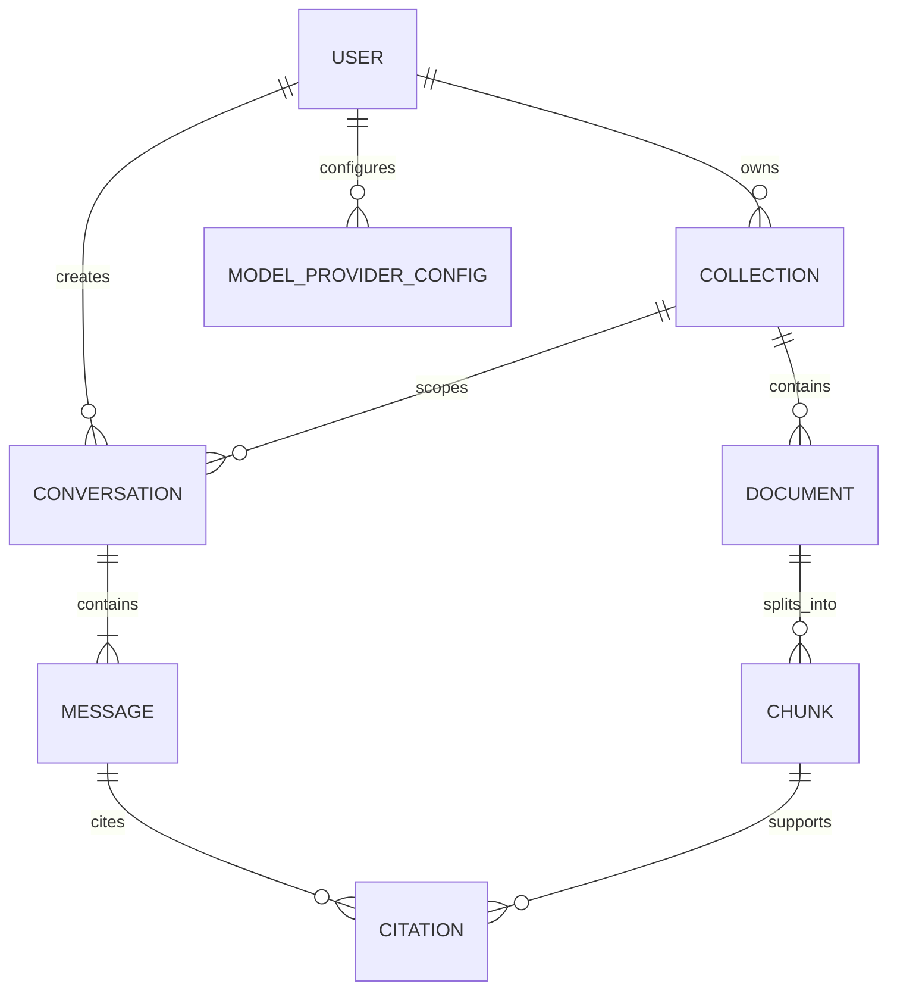

# 面向个人多文件资料的知识库问答系统

## 产品需求文档（PRD）

| 字段 | 内容 |
|---|---|
| 文档版本 | v1.2 |
| 项目题目 | 面向个人多文件资料的知识库问答系统设计与实现 |
| 产品名称（暂定） | 个人知识库问答助手 |
| 项目类型 | 多文件知识问答 Web 原型 |
| 文档状态 | 根据 RAG 工程资料修订 |

## 1. 一句话定位

帮助用户在自己上传的一组文件中提问、跨文件查找答案，并通过原文引用核验回答依据；资料没有覆盖的问题会明确说明。

## 2. 目标用户与核心使用场景

### 2.1 目标用户

- **个人用户：**需要管理和查阅自己的多份资料；典型用户包括学生、研究者和知识工作者。

### 2.2 核心使用场景

用户创建个人资料集，上传多份相关文件，然后围绕资料集提问。例如：“这几份报告对项目风险的结论有什么异同？”Agent 只在当前用户自己的资料集中检索依据，按要点组织回答，并列出对应文件、页码或章节及原文片段。若资料只支持部分结论，Agent 说明哪些部分有依据、哪些部分无法确认。

## 3. 核心功能列表（MVP）

### 3.1 本地单用户与资料归属

- 系统按本地单用户运行，首次启动自动创建或复用本机用户，不需要注册、登录或退出。
- 所有资料集、文件和问答记录自动归属本地用户，不提供多用户切换。
- 单用户模式只适合本机或可信内网环境，默认只监听回环地址。

### 3.2 模型服务设置

- 用户可以在设置页面选择系统支持的模型服务商，填写自己的 API Key，并分别配置可用的 Embedding 模型和回答模型。
- 用户可以测试连接、更新或删除已保存的服务配置；页面只显示配置状态和掩码后的 Key，不再次返回完整 Key。
- 测试连接可能调用服务商接口并消耗用户账户额度；系统应在设置页说明这一点。
- API Key 由后端加密保存并仅在后端调用模型；不得存入浏览器本地存储、前端构建产物或日志。
- 系统需说明：入库时片段文本会发送给所选 Embedding 服务；提问时问题和检索到的片段会发送给所选回答服务。使用云服务时，资料内容受相应服务商的数据条款约束。
- 用户需要在模型服务商处自行申请 API Key 并承担该服务的费用；系统删除本地 Key 配置不会代替用户在服务商处撤销该 Key。
- 资料集一旦开始建立向量索引，就记录所用 Embedding 服务商、模型标识和向量维度；切换 Embedding 模型前必须重建该资料集的全部向量索引，重建成功后再切换。

### 3.3 资料集与文件管理

- 用户可以创建、命名和删除资料集。
- 用户可以向资料集上传多份文本型 PDF、DOCX 或 Markdown 文件。
- 显示每份文件的名称、处理状态和失败原因。
- 用户可以查看文件列表、停用或删除文件。
- 首期文件大小上限建议为 100 MB；不支持的格式应明确提示。
- 检测内容完全相同的重复文件并提示用户；相同文件不得重复写入检索索引。

### 3.4 文件解析与检索准备

- 提取文件正文，并按段落或标题切分为可检索片段。
- 优先沿标题、段落和句子边界切分，保留必要的标题上下文；相邻片段可少量重叠，具体切分参数通过评测调整。
- 保留片段对应的文件名、页码或章节等来源位置，确保检索结果可回到原始资料。
- 解析完成后，资料集中的文件可用于后续问答；处理失败的文件不得进入检索结果。
- 文件解析完成后应显示处理状态；对空文本、无法解析或明显提取不完整的文件显示失败或提醒，不把空内容写入检索索引。

### 3.5 多文件资料问答

- 用户选择一个资料集后输入问题。
- Agent 只从当前用户有权访问的所选资料集中检索相关片段；检索时即应用用户和资料集范围限制。
- 检索应兼顾语义相似内容和关键词精确匹配，并对候选片段合并排序后再交给 Agent 组织回答。
- 回答中的来源可以展开查看文件名、页码/章节及原文片段。
- 支持对同一会话中的回答继续追问。

### 3.6 证据检查与不足处理

- 回答中的关键结论需关联到实际检索到的资料片段。
- 对包含多个问题的提问，Agent 分项检索并标示各部分的证据情况。
- 同一会话中的追问可以结合最近对话补全指代和省略信息；改写不得添加用户没有表达的事实，原始问题需保留用于会话记录。
- 仅从用户明确提出的条件中提取文件名、时间等检索过滤项；用户权限和资料集范围由后端强制设置，不接受模型生成或放宽权限条件。
- 资料只支持部分答案时，只回答有依据的部分，并指出未覆盖内容。
- 没有足够资料依据时，明确提示无法从当前资料集中确认，不编造来源。
- 上传资料只作为待检索内容；资料中要求改变系统行为、泄露信息或调用工具的文字不得覆盖系统规则。
- 回答引用必须属于本轮检索结果；系统需校验引用编号和来源位置。回答中不渲染未经安全处理的远程图片或任意外链。

### 3.7 会话记录

- 保存用户在资料集中的会话、问题、回答和引用。
- 用户可以查看和删除自己的会话。

## 4. 主要数据对象及它们之间的关系

| 数据对象 | 主要字段/用途 |
|---|---|
| User（本地用户） | 用户 ID、标识邮箱、状态、首选模型、创建时间 |
| ModelProviderConfig（模型服务配置） | 配置 ID、用户 ID、服务商标识、加密后的 API Key、Embedding/回答模型名、连接状态、更新时间 |
| Collection（资料集） | 资料集 ID、所属用户 ID、名称、Embedding 服务商/模型标识和向量维度、创建时间 |
| Document（文件） | 文件 ID、资料集 ID、文件名、格式、版本/校验标识、解析状态、上传时间、停用/删除状态 |
| Chunk（资料片段） | 片段 ID、文件 ID、片段指纹、文本内容、片段顺序、标题路径、页码/章节、向量和关键词索引标识 |
| Conversation（会话） | 会话 ID、所属用户 ID、资料集 ID、标题、创建时间 |
| Message（消息） | 消息 ID、会话 ID、提问/回答角色、正文、创建时间、回答状态 |
| Citation（引用） | 回答消息 ID、资料片段 ID、展示的来源位置和引用文本快照 |

### 4.1 关系说明

- 一个用户可以创建多个资料集；每个资料集属于一个用户。
- 一个资料集包含多份文件；一份文件只属于一个资料集。
- 一份文件解析后生成多个资料片段。
- 一个用户可以在一个资料集中创建多个会话；一个会话包含多条消息。
- 一条 Agent 回答可以包含多个引用；每条引用指向一个实际资料片段。
- 一个用户可以配置一个或多个模型服务商；配置只对该用户生效。

## 5. MVP 范围边界

### 纳入范围

- 用户上传的文本型文件及其资料集内的问答。
- 多文件检索、回答引用、证据不足时的部分回答或拒答。
- 资料处理状态、会话历史和用户数据隔离。

### 暂不纳入

- 扫描件 OCR、图片/音视频理解和复杂表格解析。
- 互联网搜索、第三方云盘同步和资料集分享。
- 自动生成报告、试题或摘要等非问答功能。
- 复杂团队权限、管理员后台、高并发和生产级云部署。

## 6. MVP 验收建议

1. 用户能够创建资料集、上传支持的文件，并看到解析成功或失败状态。
2. 用户能够针对资料集提问，回答可追溯到真实文件片段及正确页码/章节。
3. 多文件问题可以展示来自不同文件的引用。
4. 对资料未覆盖的问题，系统明确说明无法确认；对部分有依据的问题，不把未覆盖内容当作事实回答。
5. 用户无法访问其他用户的资料集、文件和会话。
6. 删除或停用文件后，该文件不再参与新检索；已有会话中的引用仍保留其来源位置和引用文本快照。
7. 使用人工核对的问题集比较检索结果和回答依据，检查引用位置、答案支持度及无答案问题的拒答表现，并如实记录结果。
8. 抽样核对原文件与解析文本，记录解析失败和内容缺失案例；解析失败的资料不得进入检索结果。
9. 同一会话中的代词追问能结合前文检索；无关的新问题不会错误继承旧话题。
10. 上传重复文件不会产生重复片段；替换文件后，新问题不应检索到旧版本内容。
11. 用户可配置、测试、更新和删除模型 API Key；界面与日志不暴露完整 Key，用户之间不能读取彼此配置。

## 7. 设计约束与待确认项

- 本 PRD 将“资料集”定义为一组由同一用户上传、用于同一类问题的文件。
- MVP 暂不区分个人资料和团队共享资料；后续如需协作，再扩展成员与角色权限。
- 文件格式和大小限制属于首期实施建议，可结合实际解析能力调整。
- 混合检索的候选数量、最终上下文数量、切片长度与重叠比例均为待评测参数；不得直接把外部文章中的效果数字当作本项目目标或结果。
- 首期优先实现语义检索、关键词检索及候选融合；是否加入独立 Reranker、HyDE 或多角度查询扩展，应由本项目评测收益、延迟和实现成本决定。
- 问题改写只处理同一会话内的追问和明确的复合问题；长期个人记忆、跨会话画像、自动生成每个片段的上下文说明不属于 MVP。
- 相关性阈值必须按本项目模型和评测集确定，不直接套用外部文章中的固定分数。
- 文件版本更新首期可整份重新解析与建索引；按片段增量重建属于后续性能优化。
- 切换 Embedding 模型会改变向量空间，必须为资料集全量重建索引；不得在同一索引中混用不同模型生成的向量。
- 用户输入的服务商只允许从后端维护的支持列表中选择，不接受任意 API 地址，避免把后端请求转发到不受信任的主机。
- 项目评测应报告实际数据和失败案例，不将预期指标写成已达到的结果。
